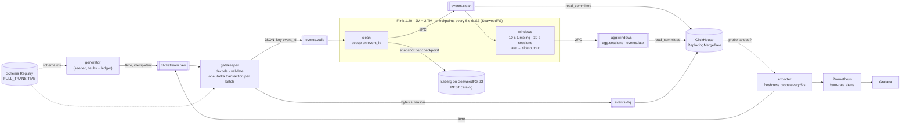

# streaming-platform

[](https://github.com/technobasant/streaming-platform/actions/workflows/ci.yml)
[](LICENSE)


**Every event counted once, at every layer — and counted, not assumed.** A real-time
data platform for the storefront clickstream of a fictional homewares retailer, Lumen
& Loom: contracts at the front door, exactly-once processing through Kafka and Flink,
ClickHouse for queries a few seconds old, Iceberg for the record, and a freshness SLO
that pages when the pipeline stalls.

Shoppers browse, add to cart, check out and pay, from the web app and the public API.
The events arrive the way real ones do: some twice, some out of order, some minutes
late, a few not even valid. A seeded generator sends that traffic and writes a ledger
of every fault it injected; a reconciler then counts each run at every layer —
Kafka, Flink's output, ClickHouse, the Iceberg table, the dead-letter topic — against
the ledger. Exactly-once is a claim about counts, so that is how it is checked: in
steady state, through a broker kill, through a TaskManager kill, and through a stall.

## What the runs showed

All figures come from [MEASUREMENTS.md](MEASUREMENTS.md), which has the method, the
environment and every run. Medians of three runs unless stated.

| Question | Measured |
|---|---|
| Is anything lost or counted twice? | Steady state: 9 runs, 2.7 million unique events with every fault injected — **every layer exact**: Kafka, ClickHouse, Iceberg, dead-letter topic and table, late side output, window counts |
| …through failures? | **Every event layer exact** through 3 broker kills (the active controller each time), 3 TaskManager kills and 3 150-second stalls. Restarts rewrote 658–7,522 records that aborted transactions had written; no `read_committed` reader saw them |
| How fresh is ClickHouse? | Event time to queryable: p50 3.4 / 3.7 / 4.9 s and p99 6.1 / 6.6 / 9.1 s at 1,000 / 3,000 / 6,000 events/s. The floor is the 5 s checkpoint interval; 6,000/s is close to the deduplicating job's limit |
| Does a stalled pipeline page? | Both TaskManagers frozen: the fast-burn alert fired **59–62 s** in and cleared about 45 s after they resumed |
| What does a broker kill cost? | 0 failed sends; writes paused about 10 s until the dead broker left the ISRs. In one run it was the gate's transaction coordinator, and the pipeline waited ~70 s (the fix is not yet re-measured) |
| What does a TaskManager kill cost? | Noticed in 8–9 s, state restored 10–13 s after the kill, every task running again after 14–63 s |
| Is bad data contained? | The dead-letter queue held exactly the injected poison in every run. Three breaking schema changes refused with HTTP 409 and the field named; a producer on an unregistered schema cannot send; a v2 rollout, 29,970 events, none refused |
| Where is it weakest? | **The window aggregates under failure.** Every failure moved on-time events to the late side output — up to 40% of one broker-kill run — because catching up reorders partitions beyond the 5 s watermark bound; and two restores lost 95–276 late events from both windows and side output (they remain in the raw table and the lake) |
| Does it stay that way? | Not quite: after about four hours of experiments, two 1,000/s runs had p99 of 23–25 s instead of 6 s, with checkpoints stretching to 32 s and SeaweedFS at its 512 MB memory cap. Not root-caused yet |
| How fast are queries on fresh data? | p50 8–26 ms, p95 30–84 ms for five dashboard queries on 6 million rows while ingesting 2,000 events/s |

Each failure here changed the design; the [failure log](#failure-log) lists what and where.

## Architecture



Kafka is three KRaft nodes (each broker and controller), every topic replicated three
times with `min.insync.replicas=2`. Everything runs as one container per node.

## Quick start

Needs Docker with about 11 GB of memory for the VM, `make`, and
[uv](https://docs.astral.sh/uv/) for the tests and measurements.

```sh
make up      # build, start, wait for health, submit both Flink SQL jobs (~3 min cold)
make demo    # 60 s of traffic with every kind of fault, then reconcile every layer
make down
```

`make demo` ends with the reconciler's report, abridged:

```
ledger             29,999 events · 29 poison · 313 late · 1,487 out of order · 599 resent
events.valid       rows 30,569  unique 29,970  missing 0  unexpected 0   exact
events.clean       rows 29,970  unique 29,970  missing 0  unexpected 0   exact
events.dlq         rows 29   exact
events.late        rows 313   exact
clickhouse.events  rows 29,970  unique 29,970  missing 0  unexpected 0   exact
windows_vs_late    windows 29,657 + late 313 = 29,970   exact
clickhouse.dlq     rows 29   exact
iceberg.events     rows 29,970  unique 29,970  missing 0  unexpected 0   exact
exact              true
```

Then open Grafana at http://localhost:13000 (the dashboard is the home page), Flink
at http://localhost:18081 and Prometheus at http://localhost:19090.

```sh
make contract-check     # against the live registry: v2 accepted, three breaking changes refused
make measure-load       # the measurements in MEASUREMENTS.md (also -broker-kill, -tm-kill, -stall, ...)
make ci-local           # ruff, mypy, pytest, docker compose config
```

## Decisions

| Choice | Over | Why | ADR |
|---|---|---|---|
| Apache Kafka 4.3, three KRaft nodes | Redpanda | Flink's exactly-once sink and librdkafka's transactions are built and tested against it; Apache-2.0 | [1](docs/adr/0001-apache-kafka-kraft.md) |
| A transactional gatekeeper in front of Flink | Flink's `avro-confluent` format | The format can fail the job or drop a bad record silently; it cannot route one to a dead-letter topic with a reason, or apply business rules | [2](docs/adr/0002-transactional-contract-gate.md) |
| Avro, `FULL_TRANSITIVE`, no auto-registration | BACKWARD; Protobuf | Producers and consumers deploy in any order, and old data stays readable by new code and the reverse | [3](docs/adr/0003-avro-full-transitive.md) |
| Transactions to Kafka, then `read_committed` into `ReplacingMergeTree` | a JDBC upsert sink | Every Flink sink stays two-phase-commit; ClickHouse's at-least-once ingest is made harmless by the table's key | [4](docs/adr/0004-exactly-once-end-to-end.md) |
| Iceberg REST catalog fixture; SeaweedFS for S3 | Hive Metastore, Nessie, Polaris | One small JVM, no database; the Flink side is the production REST configuration | [5](docs/adr/0005-iceberg-rest-catalog.md) |
| Deduplicate by arrival; windows by event time; late events to a side output | allowed lateness with updating windows | Append-only outputs for transactional sinks, and no event silently dropped | [6](docs/adr/0006-event-time-dedup-and-late-data.md) |
| A freshness SLO measured by probes, multi-window burn-rate alerts | `now() - max(event_time)` | A probe measures the whole path and keeps measuring at zero traffic | [7](docs/adr/0007-freshness-slo-probes.md) |

## Failure log

What broke while building this, and what changed.

| What happened | Why | Fixed in |
|---|---|---|
| Brokers idled at ~150% CPU each | The healthcheck started a JVM every 5 s per broker; every earlier measurement was discarded | 5e7c2b0 |
| The windows job topped out near 2,800 events/s | RocksDB access per record for small, short-lived state | f0eb519 |
| ClickHouse's dead-letter table stopped filling; its consumer group sat in `CompletingRebalance` for 15+ min | Kafka 4.1.0's group coordinator wedged after the VM clock stepped back ([KAFKA-19888](https://issues.apache.org/jira/browse/KAFKA-19888)) | 65e3d70 |
| A broker kill turned 1.7% of on-time events late | Stalled partitions declared idle after 10 s | 19c2903 |
| 452 events counted both in a window and as late | The late filter and the windows saw different watermarks at parallelism 2 | 3673d7b |
| The exporter died during broker kills; probes stopped | librdkafka 2.16.0 aborts in a timed-out admin request ([librdkafka#4605](https://github.com/confluentinc/librdkafka/issues/4605)) | 184804c |
| The gate stalled ~70 s when its transaction coordinator died | 30 s default connection-setup timeout to the dead host | c1f5e85 (not re-measured) |
| The reconciler was OOM-killed, twice | Every event id held as a string, several times; whole Iceberg table read per retry | bda5414, dc9a31d, 00d120a |
| `make up` could not pull MinIO | `minio/minio` is gone from Docker Hub | 7491ca3 |
| Anonymous Grafana viewers were denied the dashboard | Grafana 12 permissions on root-level provisioned dashboards | ab0231e |

Not fixed: restoring the windows job can drop late events that arrive before its first
new watermark (MEASUREMENTS.md, section 4). The proper fix is a side output from the
window operator itself, which Flink SQL cannot express.

## Limits

* **One host.** All nodes are containers on one Docker VM (8 vCPU, 11.7 GiB), so
  replication and network latency are local, and a CPU stall on the host slows every
  node at once. A broker kill here says nothing about network partitions.
* **The checkpoint interval is the latency floor.** Exactly-once output is visible only
  when Flink's transaction commits, every 5 s. Sub-second freshness needs a different
  trade (at-least-once with idempotent sinks), not tuning.
* **One gatekeeper.** It is a single process with one `transactional.id`; it handled
  the rates measured here, and it is the first thing to scale. When its transaction
  coordinator dies it can stall the whole pipeline (MEASUREMENTS.md, section 3).
* **Aggregates under failure.** Raw events and the lake are exact through every failure
  tested; the 10-second window counts are not — failovers and restores move on-time
  events to the late side output, and a restore can drop late events. Treat the window
  tables as fast and approximate during incidents, and the raw table as the record.
* **A killed container loses its DNS name.** Docker removes it, so clients see host
  resolution failures rather than connection timeouts — harsher than a real host
  failure for librdkafka, which then fails a transaction outright.
* **No compaction.** The Iceberg sink commits a snapshot per checkpoint; nothing
  rewrites the small files or expires snapshots. ClickHouse relies on `FINAL` and
  background merges for duplicate rows from its at-least-once Kafka engine.
* **No Alertmanager, no auth.** Alerts are read from Prometheus. The registry, the
  catalog, SeaweedFS and ClickHouse use lab-only credentials and listen on localhost.
* **SQL is checked by running it,** not by a linter: CI creates the ClickHouse schema
  and submits both Flink jobs, so a syntax or planning error fails the build.
  sqlfluff has no Flink dialect and stumbles on ClickHouse's engine settings.

## Roadmap

* Late events out of the window operator itself (a DataStream stage with a side
  output), and watermark alignment on the deduplicating job's source so that catching
  up after a failure does not reorder partitions beyond the watermark bound.
* Scale the gatekeeper out (one transactional id per instance), or replace it with a
  Flink DataStream stage with a side output.
* Iceberg maintenance: compaction and snapshot expiry as scheduled Flink actions.
* Changelog sinks for corrections: late events applied to closed windows as updates.
* Alertmanager routing, and the same SLO on per-event latency rather than probes.
* QEMU VMs instead of containers for the broker-kill test, to add real network
  faults (partition, latency) with `tc`.

## Repository layout

```
contracts/clickstream/   v1 (registered), v2 (compatible), breaking/ (must be refused)
src/streamplat/          generator, gatekeeper, exporter, reconciler, contract check
flink/sql/               10-clean.sql (dedup, Kafka + Iceberg), 20-windows.sql (windows, sessions, late)
clickhouse/              Kafka engine tables, materialized views, ReplacingMergeTree tables
docker/                  Flink image (pinned JARs), tools image, ClickHouse, Prometheus rules, Grafana
scripts/                 job submission, measurements
tests/                   unit tests; the live contract test (pytest -m registry)
docs/adr/                decisions
results/                 raw measurement output behind MEASUREMENTS.md
```

## Licence

Apache 2.0. See [LICENSE](LICENSE) and [NOTICE](NOTICE).
