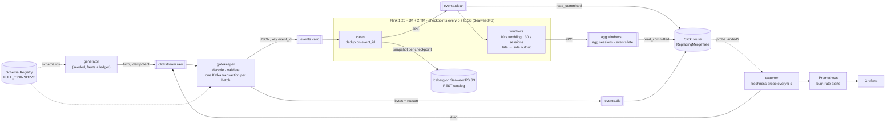

# streaming-platform

[](https://github.com/technobasant/streaming-platform/actions/workflows/ci.yml)
[](LICENSE)


**Every event counted once, at every layer — and counted, not assumed.** A real-time
data platform for the storefront clickstream of a fictional homewares retailer, Lumen
& Loom: contracts at the front door, exactly-once processing through Kafka and Flink,
ClickHouse for queries a few seconds old, Iceberg for the record, and a freshness SLO
that pages when the pipeline stalls.

Shoppers browse, add to cart, check out and pay, from the web app and the public API.
The events arrive the way real ones do: some twice, some out of order, some minutes
late, a few not even valid. A seeded generator sends that traffic and writes a ledger
of every fault it injected; a reconciler then counts each run at every layer —
Kafka, Flink's output, ClickHouse, the Iceberg table, the dead-letter topic — against
the ledger. Exactly-once is a claim about counts, so that is how it is checked: in
steady state, through a broker kill, through a TaskManager kill, and through a stall.

## What the runs showed

RESULTS_TABLE

## Architecture



Kafka is three KRaft nodes (each broker and controller), every topic replicated three
times with `min.insync.replicas=2`. Everything runs as one container per node.

## Quick start

Needs Docker with about 11 GB of memory for the VM, `make`, and
[uv](https://docs.astral.sh/uv/) for the tests and measurements.

```sh
make up      # build, start, wait for health, submit both Flink SQL jobs (~3 min cold)
make demo    # 60 s of traffic with every kind of fault, then reconcile every layer
make down
```

`make demo` ends with the reconciler's report, abridged:

DEMO_OUTPUT

Then open Grafana at http://localhost:13000 (the dashboard is the home page), Flink
at http://localhost:18081 and Prometheus at http://localhost:19090.

```sh
make contract-check     # against the live registry: v2 accepted, three breaking changes refused
make measure-load       # the measurements in MEASUREMENTS.md (also -broker-kill, -tm-kill, -stall, ...)
make ci-local           # ruff, mypy, pytest, docker compose config
```

## Decisions

| Choice | Over | Why | ADR |
|---|---|---|---|
| Apache Kafka 4.3, three KRaft nodes | Redpanda | Flink's exactly-once sink and librdkafka's transactions are built and tested against it; Apache-2.0 | [1](docs/adr/0001-apache-kafka-kraft.md) |
| A transactional gatekeeper in front of Flink | Flink's `avro-confluent` format | The format can fail the job or drop a bad record silently; it cannot route one to a dead-letter topic with a reason, or apply business rules | [2](docs/adr/0002-transactional-contract-gate.md) |
| Avro, `FULL_TRANSITIVE`, no auto-registration | BACKWARD; Protobuf | Producers and consumers deploy in any order, and old data stays readable by new code and the reverse | [3](docs/adr/0003-avro-full-transitive.md) |
| Transactions to Kafka, then `read_committed` into `ReplacingMergeTree` | a JDBC upsert sink | Every Flink sink stays two-phase-commit; ClickHouse's at-least-once ingest is made harmless by the table's key | [4](docs/adr/0004-exactly-once-end-to-end.md) |
| Iceberg REST catalog fixture; SeaweedFS for S3 | Hive Metastore, Nessie, Polaris | One small JVM, no database; the Flink side is the production REST configuration | [5](docs/adr/0005-iceberg-rest-catalog.md) |
| Deduplicate by arrival; windows by event time; late events to a side output | allowed lateness with updating windows | Append-only outputs for transactional sinks, and no event silently dropped | [6](docs/adr/0006-event-time-dedup-and-late-data.md) |
| A freshness SLO measured by probes, multi-window burn-rate alerts | `now() - max(event_time)` | A probe measures the whole path and keeps measuring at zero traffic | [7](docs/adr/0007-freshness-slo-probes.md) |

## Failure log

What broke while building this, and what changed.

FAILURE_LOG

## Limits

* **One host.** All nodes are containers on one Docker VM (8 vCPU, 11.7 GiB), so
  replication and network latency are local, and a CPU stall on the host slows every
  node at once. A broker kill here says nothing about network partitions.
* **The checkpoint interval is the latency floor.** Exactly-once output is visible only
  when Flink's transaction commits, every 5 s. Sub-second freshness needs a different
  trade (at-least-once with idempotent sinks), not tuning.
* **One gatekeeper.** It is a single process with one `transactional.id`; it handled
  the rates measured here, and it is the first thing to scale.
* **No compaction.** The Iceberg sink commits a snapshot per checkpoint; nothing
  rewrites the small files or expires snapshots. ClickHouse relies on `FINAL` and
  background merges for duplicate rows from its at-least-once Kafka engine.
* **No Alertmanager, no auth.** Alerts are read from Prometheus. The registry, the
  catalog, SeaweedFS and ClickHouse use lab-only credentials and listen on localhost.
* **SQL is checked by running it,** not by a linter: CI creates the ClickHouse schema
  and submits both Flink jobs, so a syntax or planning error fails the build.
  sqlfluff has no Flink dialect and stumbles on ClickHouse's engine settings.

## Roadmap

* Scale the gatekeeper out (one transactional id per instance), or replace it with a
  Flink DataStream stage with a side output.
* Iceberg maintenance: compaction and snapshot expiry as scheduled Flink actions.
* Changelog sinks for corrections: late events applied to closed windows as updates.
* Alertmanager routing, and the same SLO on per-event latency rather than probes.
* QEMU VMs instead of containers for the broker-kill test, to add real network
  faults (partition, latency) with `tc`.

## Repository layout

```
contracts/clickstream/   v1 (registered), v2 (compatible), breaking/ (must be refused)
src/streamplat/          generator, gatekeeper, exporter, reconciler, contract check
flink/sql/               10-clean.sql (dedup, Kafka + Iceberg), 20-windows.sql (windows, sessions, late)
clickhouse/              Kafka engine tables, materialized views, ReplacingMergeTree tables
docker/                  Flink image (pinned JARs), tools image, ClickHouse, Prometheus rules, Grafana
scripts/                 job submission, measurements
tests/                   unit tests; the live contract test (pytest -m registry)
docs/adr/                decisions
results/                 raw measurement output behind MEASUREMENTS.md
```

## Licence

Apache 2.0. See [LICENSE](LICENSE) and [NOTICE](NOTICE).
